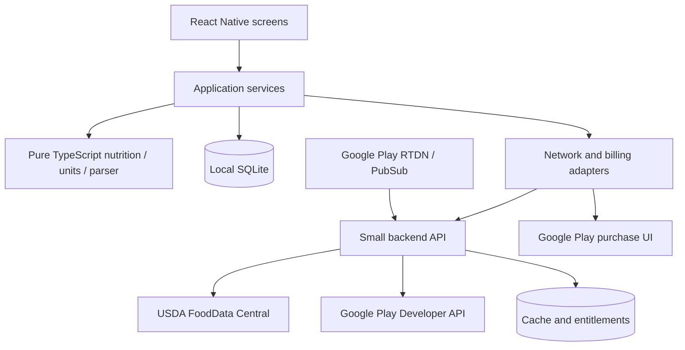

# Smart Recipe & Meal-Prep Macro Architect — React Native implementation plan

Prepared: 4 October 2026. Platform and API references were checked on this date. Estimates below are engineering estimates, not vendor commitments.

## 1. Product objective and planning assumptions

Build an Android app that helps users answer three questions: “What is in this dish?”, “What are the macros in each container?”, and “How much should I cook or buy?” The central object is a recipe with ingredients and a cooked batch, rather than a daily food diary.

Recommended foundation: React Native with TypeScript, Expo development builds, SQLite as the local source of truth, and a small TypeScript backend for USDA access and Google Play subscription verification.

Assumptions for the first release:

- Android first, English interface, adults preparing ordinary home-cooked meals.
- Manual entry of weights from the user's kitchen scale. Bluetooth scale integration is a later feature.
- Gram-based nutrition, with food-specific household measures and a selectable cup/spoon convention.
- First launch, food search within the bundled catalog, recipe editing, parsing, and portion calculations work without a connection or account.
- Online services expand food coverage and verify subscriptions; they do not calculate core recipe nutrition.
- Nutrition results are estimates based on the selected data and measurements. Do not promise laboratory precision from volume or piece inputs.
- Suggested free limit: three saved master recipes plus one autosaved working draft. This limit is a configurable product decision.
- No cloud recipe synchronization in version 1. Provide local backup/export and import to protect user data.

Select a launch region before curating the food catalog. USDA alone should not be assumed to cover every local brand or regional ingredient. For a South Asian launch, explicitly validate names and raw/cooked variants for atta, rice varieties, lentils, chickpeas, paneer, yogurt, oils, and common curry ingredients. Retain verified nutrition sources behind aliases; do not assign nutrition merely because two food names sound similar.

## 2. Scope and freemium policy

| Capability | Free | Pro | Delivery stage |
| --- | --- | --- | --- |
| Build a dish and calculate calories/macros | Unlimited calculations | Same | Core MVP |
| Grams, kg, oz, food-specific cups/spoons/pieces | Yes | Yes | Core MVP |
| Equal servings and cooked-yield calculations | Yes | Yes | Core MVP |
| Local food search and custom foods | Yes | Yes | Core MVP |
| Saved master recipes | Three suggested slots | Unlimited | Core MVP, then billing |
| Quick-paste ingredient parsing with review | Yes | Yes | Version 1 |
| Barcode scan and manual barcode entry | Yes | Yes | Version 1 |
| Grocery aggregation from selected recipes | — | Yes | Pro release |
| Uniform target-calorie recipe scaling | — | Yes | Pro release |
| PDF macro cards | — | Yes | Pro release |
| Portable backup, restore, deletion, and viewing existing data | Yes | Yes | Before public launch |

On subscription expiry, preserve every recipe and existing batch. Users can read and calculate from existing recipes, delete data, and export a portable backup. If above the free recipe limit, restrict new master saves and Pro actions; allow continued work in the draft. Never remove recipes to enforce a quota. Keep PDF macro cards distinct from the free data backup format.

Defer daily calorie logging, social feeds, AI-generated diets, medical recommendations, photo-based food recognition, Bluetooth scales, cloud sync, and URL scraping. These expand scope without proving the central recipe-to-portion workflow.

## 3. Core user journeys and screen plan

Use bottom navigation for Kitchen, Recipes, Grocery, and Settings. Kitchen opens the current draft, recent foods, and a prominent “New dish” action. Offer paste and scan entry from the same ingredient sheet rather than separate competing workflows.

| Screen | Main actions | Important states |
| --- | --- | --- |
| Onboarding | Choose unit convention; see a short sample recipe | Skip onboarding; offline startup |
| Kitchen / recipe editor | Rename dish; add/edit ingredients; view live totals | Autosaved draft; unresolved rows; undo deletion |
| Food search sheet | Search local foods; choose raw/cooked and brand | Cached results; online results; no match |
| Quantity and measure sheet | Enter quantity; select measure; inspect gram equivalent | Unknown conversion; piece size; user override |
| Paste review | Parse text; confirm food matches and measures | Ranges, alternatives, missing amounts, preparation notes |
| Barcode scanner | Scan or type UPC/EAN; select matched product | Permission denied; offline unknown barcode; no product |
| Batch setup | Enter cooked net yield, container count, or both | Pot tare helper; zero/invalid yield; missing yield |
| Portion result | Show batch, per 100 g, per serving, custom portion | Partial nutrition; estimated conversions |
| Recipe library / details | Save, duplicate, edit, search; start a batch | Free quota; preserved recipes after expiry |
| Grocery list | Select recipes and multipliers; aggregate and check off | Unresolved items; pantry exclusions; incompatible forms |
| Scaling preview | Set calorie target; review new amounts; save a copy | Per-batch versus per-serving target; cooking caveats |
| Paywall / subscription | See localized plans; subscribe; restore; manage | Pending purchase; canceled checkout; verification retry |
| Settings / data | Units, source attribution, backup/import, delete data | Offline; database/content version; last subscription check |

Main journey: new dish → find chicken → select raw breast → enter grams → add vegetables, grain, and oil → view totals → enter cooked yield/count → inspect a portion → save.

Usability requirements: readable numbers, large tap targets, TalkBack labels, large-font support, correct keyboard behavior, light/dark themes, and macro labels that do not depend on color. Display a clear “estimated” or “incomplete” status when appropriate. For a partial result, show known subtotal and the unresolved ingredients rather than a convincing-looking complete total.

## 4. Recommended technical stack

| Area | Recommendation | Purpose |
| --- | --- | --- |
| Runtime | React Native + TypeScript through Expo | Android app and typed domain logic |
| Current baseline | Expo SDK 57 / its supported React Native 0.86 release | Verified starting point; pin compatible patch versions |
| Native workflow | Expo development client and Continuous Native Generation | Camera, SQLite, billing, and native production builds |
| Navigation | Expo Router | Screen routing and deep links |
| UI | React Native components and a small shared theme/component layer | Avoid a large dependency burden before UX is stable |
| Local persistence | `expo-sqlite`, SQL migrations, FTS search | Durable recipes, catalog, snapshots, and offline search |
| UI state | Zustand for transient state | Editor selections and temporary interface state |
| Remote fetching | TanStack Query, persisting selected food records to SQLite | Request lifecycle; SQLite remains the durable cache |
| Validation | Zod at API, parser, import, and form boundaries | Reject malformed or inconsistent input |
| Scanner | `expo-camera` | UPC/EAN barcode detection |
| PDF | `expo-print` + `expo-sharing` | Local macro card generation and sharing |
| Sensitive local tokens | `expo-secure-store` | Installation session credentials and entitlement token |
| Billing | `expo-iap` behind a billing adapter | Google Play purchases with owned server verification |
| Backend | Node.js/TypeScript with Fastify; managed PostgreSQL | USDA proxy/cache, purchase verification, subscription events |
| CI/builds | GitHub Actions and EAS Build, or an equivalent native build pipeline | Checks, development APKs, production AABs |
| Tests | Jest, React Native Testing Library, Maestro | Domain, integration, and Android flow coverage |

Expo SDK 57 includes the React Native 0.86 baseline. Follow the selected SDK's Node, Android, Kotlin, and Gradle compatibility requirements; use `npx expo install` for Expo-compatible packages instead of choosing independent “latest” native dependency versions. [Expo SDK 57](https://expo.dev/changelog/sdk-57?q=sdk), [Expo SDK reference](https://docs.expo.dev/versions/latest/).

Use a development build from the first native integration spike. Google Play billing cannot be validated in Expo Go. Expo currently documents both `expo-iap` and the RevenueCat-backed `react-native-purchases` option. [Expo in-app purchases](https://docs.expo.dev/guides/in-app-purchases/).

Recommended decision: own billing verification with `expo-iap` because this design already needs a USDA backend. RevenueCat remains a reasonable substitute if reducing subscription operations is more valuable than owning that infrastructure. Choose one purchase integration, not both. Validate the final Expo/IAP combination on a physical Android device before committing to it; OpenIAP documents its Expo setup and native requirements. [OpenIAP Expo setup](https://www.openiap.dev/docs/setup/expo).

## 5. Architecture and project layout



```text
apps/mobile/
  app/                         Expo Router screens
  src/components/              Shared UI
  src/features/recipes/        Editing and library
  src/features/foods/          Search, custom food, matching
  src/features/import/         Paste review
  src/features/batches/        Yield and portions
  src/features/grocery/        Grocery generation
  src/features/billing/        Purchase and entitlement UI
  src/data/                    SQLite repositories and migrations
  src/services/                Application commands and adapters
  assets/catalog/              Versioned seed database
apps/api/
  src/foods/                   USDA proxy and normalized cache
  src/billing/                 Verification and RTDN handling
  src/installations/           Anonymous installation sessions
packages/domain/
  nutrition/ units/ parser/ scaling/ grocery/ schemas/
tools/catalog/                 Reproducible catalog import and QA
```

The shared domain package must not import React, network clients, or database APIs. Expose pure operations such as `resolveIngredientWeight`, `calculateRecipe`, `calculatePortion`, `parseIngredientLine`, `scaleRecipe`, and `aggregateGroceries`.

UI input → validated application command → database transaction → updated editor view. Calculate live previews from in-memory validated ingredient snapshots; persist confirmed changes. Components display results rather than implementing their own nutrient math. Recover the last committed draft after process death. For multi-field editing, make save status visible and flush valid changes on confirmation/backgrounding; never rely only on unmount or background callbacks.

## 6. Local data model

Use UUID identifiers, foreign keys, explicit database migrations, transactions, and UTC timestamps. Store decimal values without rounding each intermediate calculation; round only at presentation boundaries. Persist original input alongside resolved weight so users can audit or edit it later.

| Table | Important fields |
| --- | --- |
| `foods` | id, canonical_name, brand, preparation_state, category, source, source_id, source_version, basis_type, basis_amount, nutrient_values, provenance, fetched_at, catalog_version |
| `food_aliases` | food_id, alias, locale, normalized_alias |
| `food_measures` | id, food_id, amount, unit, grams, descriptor, unit_convention, source, quality |
| `food_barcodes` | food_id, barcode_text, symbology, market_country, source |
| `custom_foods` | food_id referencing a `foods` row with source `custom`, entered_nutrients, original_basis, grams_per_serving, density_if_known, notes |
| `recipes` | id, title, current_revision_id, tags, created_at, updated_at, archived_at |
| `recipe_revisions` | id, recipe_id, revision_number, default_servings, notes, created_at |
| `recipe_ingredients` | id, revision_id, position, food_id, quantity, unit, measure_id, grams, conversion_snapshot, nutrient_snapshot, original_text, resolution_status |
| `drafts` | id, editor_payload, committed_at, schema_version |
| `batches` | id, recipe_revision_id, cooked_yield_g, container_count, nutrient_totals_snapshot, ingredient_snapshot, created_at |
| `batch_portions` | id, batch_id, portion_g or equal_share_fraction, label, nutrient_snapshot |
| `grocery_lists` | id, title, source_selection_snapshot, created_at |
| `grocery_items` | id, list_id, canonical_food_id, purchase_form, required_g, pantry_g, display_quantity, checked, resolution_status |
| `content_metadata` | catalog_version, importer_version, last_successful_update, checksum |
| `settings` | unit convention, rounding preferences, theme, onboarding state |
| `entitlement_metadata` | entitlement, paid_through, offline_valid_until, last_verified_at; signed token in secure storage |

Nutrition values have nullable kcal, protein_g, carbs_g, fat_g, and fiber_g. Persist missing-value status and provenance. Water and salt can have verified zero energy, but unknown energy is never automatically zero.

Snapshot nutrients and measure conversions when a recipe revision is saved. Catalog updates must not silently change saved batch history. Let users explicitly refresh a recipe's food data, preview the change, and create a new revision. Batches capture the revision and yield used at cooking time; editing a master recipe must not alter old portions.

Index normalized food names, aliases, source identifiers, and barcode text; use SQLite FTS for local text search. Treat barcode values as strings to preserve leading zeroes. Separate user-owned custom foods from refreshable catalog entries even if they share one database. Parameterize SQL queries and escape/sanitize FTS query syntax. Expo SQLite supports persistent databases and configurable full-text search. [Expo SQLite](https://docs.expo.dev/versions/latest/sdk/sqlite/).

## 7. Food catalog and USDA integration

### Bundled catalog pipeline

1. Download a fixed USDA release and store its version in the import manifest.
2. Select approximately 1,500–3,000 useful ingredient records as an initial curation target; adjust after coverage testing.
3. Prefer suitable Foundation, SR Legacy, and FNDDS records for ordinary ingredients; use Branded records for identified products. Evaluate each match rather than treating the source name as a guarantee of completeness.
4. Map reviewed nutrient identifiers and units into the five supported nutrients. Select one appropriate energy value; do not add multiple energy methodologies together.
5. Preserve raw/cooked, drained/undrained, edible-portion, and preparation distinctions.
6. Import food-specific portion weights and reviewed aliases.
7. Validate nutrient basis, conversions, duplicates, and missing fields; run known recipe fixtures.
8. Generate an indexed SQLite asset and version/checksum manifest. Measure actual APK and installed database size rather than assuming the whole USDA database is small enough to bundle.

USDA supplies downloadable datasets, and FoodData Central data are public-domain/CC0; include USDA attribution and dataset release details in Settings. [USDA downloads](https://fdc.nal.usda.gov/download-datasets/), [USDA API guide](https://fdc.nal.usda.gov/api-guide/).

### Search and cache behavior

- Search the local catalog, custom foods, and previously fetched foods first.
- Rank exact names and aliases, preparation-state matches, recent selections, then fuzzy matches.
- Offer “Search online” if local results are insufficient. Distinguish cached versus online source without cluttering the interface.
- Use backend endpoints for search and food details. Cache normalized upstream responses; save user-selected online food details locally for future offline use.
- If the network fails or rate limiting occurs, keep local results and allow manual custom-food entry.
- Catalog updates insert/update catalog records transactionally, preserve custom data and snapshots, and update the content version only after validation succeeds. Failed updates leave the existing catalog usable.

Do not embed the USDA key in the Android binary or an `EXPO_PUBLIC_` variable. USDA requires key privacy and currently documents a default 1,000 requests per hour per IP address. A shared backend concentrates traffic on its outbound IP, so use caching, quotas, request coalescing, backoff, and rate-limit monitoring; request higher limits before exceeding capacity. [USDA API guide](https://fdc.nal.usda.gov/api-guide/).

Inspect the original nutrient basis, especially for branded data and liquids. Normalize to per 100 g only when a trustworthy mass conversion exists. Keep per-100-ml records explicitly marked if density is unavailable; do not relabel them as per-100-g or allow them to produce a fabricated complete gram-based batch result. USDA describes the branded-food normalization process and its underlying label data. [USDA branded-food documentation](https://fdc.nal.usda.gov/GBFPD_Documentation/).

## 8. Measurement conversion engine

Resolution order:

1. Direct mass: grams, kilograms, ounces, and pounds.
2. A matching food-specific household measure with the correct preparation and convention.
3. A food-specific density for volume input, when appropriate.
4. A food-specific piece count and descriptor, such as one medium egg or one garlic clove.
5. A user-confirmed gram override, optionally saved as a personal conversion.
6. Unresolved state asking for a gram weight when no trustworthy conversion exists.

For a record where `measure.amount` cups correspond to `measure.grams`:

```text
ingredient_grams = input_quantity / measure.amount × measure.grams
```

For valid liquid density:

```text
ingredient_grams = input_volume_ml × density_g_per_ml
```

For pieces:

```text
ingredient_grams = piece_count × grams_per_piece_of_selected_size
```

Do not use one cup-to-gram factor for every food. A cup of flour and a cup of oil require different weights; chopped, packed, grated, or drained states can also change a measure. A “piece” requires an actual food and size definition. Do not apply a US cup measure directly to a metric cup input; resolve compatible measures or make the assumption explicit.

Store the user's chosen convention, and retain it in recipe conversion snapshots. Parse metric and US volume names distinctly where specified. Require review for ambiguous tablespoon conventions, heaped spoons, handfuls, bunches, and unspecified can sizes.

Quality labels should describe evidence: “weighed”, “USDA household measure”, “density estimate”, or “custom conversion”. Any numeric confidence score needs calibration before it is presented as meaningful certainty.

USDA household measures belong to particular foods and represent edible portions; its documented portion formula uses food-specific gram weight. [USDA Foundation weights and portions](https://fdc.nal.usda.gov/Foundation_Foods_Documentation/).

## 9. Nutrition and batch calculation rules

For each resolved ingredient and nutrient:

```text
ingredient_nutrient = grams × nutrient_per_100g / 100
batch_nutrient = sum(ingredient_nutrient)
```

The source-provided calorie value is primary. A 4/4/9 macro-energy estimate may be a labeled fallback where the inputs are complete and appropriate, but should not replace valid source energy or be presented as an exact reconciliation. Fiber is reported separately and is generally included within carbohydrate totals; do not add fiber to carbohydrate mass or count it twice in macro displays.

Show macro grams prominently. If showing energy percentages, label them as approximate macro-energy shares, and explain that they can differ from source calories. Missing nutrient values remain missing: a recipe may have complete calories but incomplete fiber, for example. Maintain completeness separately for each nutrient.

### Equal containers

```text
per_container_nutrient = batch_nutrient / container_count
```

Container count must be a positive integer. Without cooked yield, per-container macros are available but gram density is unavailable. Equal-container estimates assume the batch is divided evenly.

### Cooked yield and custom portions

```text
per_100g_cooked = batch_nutrient / cooked_yield_g × 100
custom_portion_nutrient = batch_nutrient × portion_g / cooked_yield_g
```

With both count and yield, suggest `cooked_yield_g / container_count` grams per container. If portions have unequal weights, calculate each from its weight. If users record allocations, track the remaining weight and prevent allocating more than the measured batch. Before yield is known, allow equal-share allocation only; support consistent reconciliation if the user later supplies yield.

Cooked yield is the net edible dish weight, excluding the pot. Offer an optional total-minus-tare helper. Evaporation or added water changes density, not the ingredient-derived total energy by itself. Weighing the finished dish does not determine nutrient losses from discarded oil, drained liquid, bones, or leftovers in the pan. In version 1, assume entered edible ingredients are retained; let users edit consumed amounts and show the assumption. Advanced nutrient retention models are later work.

Raw rice and cooked rice must be separate food selections. If users enter raw ingredients and finished yield, do not additionally substitute cooked-food nutrition. Density calculations also assume a reasonably even distribution of ingredients; a chicken-heavy scoop of curry may differ from a gravy-heavy scoop.

### Arithmetic acceptance fixture

The following is synthetic test data, not a real recipe's nutrition claim:

```text
Batch: 2,000 kcal; 160 g protein; 200 g carbohydrate;
       60 g fat; 24 g fiber
Cooked yield: 2,000 g; containers: 5

Per container: 400 g; 400 kcal; 32 g protein;
               40 g carbohydrate; 12 g fat; 4.8 g fiber
Per 100 g: 100 kcal; 8 g protein; 10 g carbohydrate;
           3 g fat; 1.2 g fiber
250 g portion: 250 kcal; 20 g protein; 25 g carbohydrate;
               7.5 g fat; 3 g fiber
```

Changing only yield to 1,600 g retains 2,000 batch kcal and 400 kcal per equal container; it changes density to 125 kcal per 100 g and suggested container weight to 320 g. Reject zero yield/count and non-finite values. Preserve internal precision and round displayed calories to whole numbers and macros to a sensible precision.

## 10. Quick-paste parser

Build a deterministic offline parser first. The MVP does not need an LLM, a cloud call, or a blog scraper. Users paste ingredient lines or recipe text and review extracted rows before confirming.

Pipeline:

1. Split lines and identify likely ingredient sections; show uncertain prose for review rather than silently treating instructions as ingredients.
2. Normalize whitespace, bullets, Unicode fractions, mixed fractions, decimal formats, and unit aliases.
3. Extract quantity, range, unit, package count/size, ingredient name, and preparation notes.
4. Resolve local synonyms and retrieve candidate foods using local search.
5. Match food state and a compatible household measure.
6. Produce reviewable rows with structured status/reasons.
7. Save confirmed ingredients in one transaction; retain original text per row for traceability.

| Pasted text | Expected treatment |
| --- | --- |
| `500 g chicken breast` | Parse 500 g; confirm raw/cooked food selection |
| `1½ cups chopped onion` | Parse 1.5 cups; require chopped-onion measure |
| `2 tbsp olive oil` | Parse amount and unit; use selected spoon convention and oil conversion |
| `3 medium eggs` | Resolve medium-egg edible piece weight |
| `1 can (400 g) chickpeas, drained` | Preserve package detail; ask for drained weight if 400 g is gross contents |
| `2–3 cloves garlic` | Preserve range and request chosen quantity |
| `salt to taste` | Unquantified row; require an explicit decision, even if verified energy is zero |
| `chicken or tofu` | Alternative ingredients; ask user to choose |
| `1 cup rice, cooked` | Cooked-rice food and compatible cup measure |

Do not commit uncertain matches automatically. Allow choosing a food, editing a quantity, supplying grams, or explicitly excluding a row. Exclusions must be visible in the result's completeness status. Oils, nuts, sauces, sugar, and seasonings with calories must not disappear because their quantities are inconvenient.

Maintain an annotated launch-language corpus of at least 200 ingredient lines. Track quantity extraction, unit extraction, food-match accuracy, and correction rate separately. Initial acceptance targets: at least 95% quantity/unit extraction on supported unambiguous corpus examples and explicit flags for every deliberately ambiguous fixture; measure rather than claim general recipe comprehension.

## 11. Barcode workflow

Use `expo-camera` for UPC/EAN detection; scanning gives an identifier rather than nutrition. Validate format/check digit where applicable, preserve leading zeroes, suppress repeated frames, and pause scanning during lookup. Camera scanning is supported by Expo's camera module. [Expo Camera](https://docs.expo.dev/versions/latest/sdk/camera/).

Lookup order: local barcode cache → backend USDA branded search → exact comparison against returned `gtinUpc` → user-confirmed product. Apply standards-aware UPC/EAN normalization while retaining the original value; do not accept the first keyword search result as a barcode match. USDA documents GTIN/UPC identifiers in branded records. [USDA field descriptions](https://fdc.nal.usda.gov/portal-data/external/dataDictionary).

Show brand, serving basis, and nutrition before adding. Cache confirmed products. Unknown barcode while offline should offer custom label entry and retry later. Regional branded coverage must be tested before marketing broad barcode support. Manual label entry should accept per serving, per 100 g, or per 100 ml and require a valid gram conversion for gram-based use.

Request camera permission only when scanning. Disable audio recording permissions for this scanner. Handle denial gracefully and provide typed barcode input. Unmount the camera when the screen loses focus.

## 12. Pro features

### Grocery aggregation

1. Select saved recipe revisions and batch multipliers or desired serving counts.
2. Resolve each ingredient's required purchase form and weight.
3. Aggregate by canonical food/purchase identity, retaining incompatible forms separately.
4. Subtract user-confirmed pantry quantities, clamp purchase need at zero, and preserve the original requirement.
5. Display grams as the base quantity, with optional supported piece/package suggestions.
6. Save a source snapshot and provide an explicit refresh when underlying recipes change.

Example: two recipes require 500 g and 300 g of the same raw chicken cut. One batch of the first and two batches of the second require `500 + 2 × 300 = 1,100 g`.

Do not automatically combine dry chickpeas and canned drained chickpeas, raw and cooked rice, or nutritionally distinct products. A manually confirmed grocery merge can consolidate purchases without changing recipe nutrition. Cooked-food weights require a verified purchase/yield conversion to become dry purchase weights; otherwise mark them for review. If package size is known, round package count up and show the extra amount.

### Target-calorie scaling

Expose two explicit modes:

```text
Batch target:
factor = desired_batch_kcal / current_batch_kcal

Per-serving target with fixed count n:
factor = desired_per_serving_kcal × n / current_batch_kcal

scaled_ingredient_g = original_ingredient_g × factor
```

Show a preview and save as a new recipe revision/copy. Block scaling when calories or required conversions are incomplete. Keep unrounded weights for calculation; when the user accepts practical rounding, recalculate and display the achieved calorie target. Preserve integer/piece constraints for eggs and similar ingredients.

Uniform scaling changes batch size while retaining approximate macro proportions; it does not change calories per gram of the same composition and yield ratio. Changing just the portion weight can achieve a serving-calorie target without changing the master recipe. Distinguish those actions in the interface. If a previously cooked recipe is scaled, show predicted yield as an estimate and require a new measured yield for an actual batch. Do not imply that cooking time, pan size, salt, or spices scale perfectly. Constraint-based recipe reformulation is outside version 1.

### PDF macro cards

Generate an escaped HTML template from a saved batch snapshot and render locally to PDF. Include recipe/batch name, ingredients and grams, batch totals, serving count, measured yield if provided, per-serving macros, per-100-g values when available, calculation date, and source/estimate notes. Use embedded fonts/assets without network dependencies; keep user input escaped. Share through Android's share sheet. Expo Print supports HTML-based PDF generation. [Expo Print](https://docs.expo.dev/versions/latest/sdk/print/).

Test A4 and Letter output, long titles, many ingredients, missing values, large text, and page breaks. Avoid splitting the main macro card across pages. Generate PDF locally so the full recipe need not be uploaded.

## 13. Backend API and security boundaries

The backend does not store recipe content in version 1. Store normalized food cache, installation sessions, purchase tokens securely, and entitlement state. Use a managed runtime capable of background retries and Google Pub/Sub/RTDN delivery; do not rely only on an in-memory request handler.

| Endpoint | Function |
| --- | --- |
| `POST /v1/installations` | Issue an anonymous installation identity and server session |
| `GET /v1/foods/search` | Validated search, prepared-state filters, cached USDA lookup |
| `GET /v1/foods/:sourceId` | Normalize/cache a selected food record |
| `GET /v1/barcodes/:code` | Exact verified barcode match or explicit no match |
| `GET /v1/catalog/manifest` | Catalog/content version and package integrity metadata |
| `POST /v1/billing/verify` | Verify a Google Play purchase token and update entitlement |
| `GET /v1/entitlements/me` | Return signed current entitlement and offline validity |
| `POST /v1/billing/google-notifications` | Authenticated RTDN receiver or Pub/Sub push endpoint |

Use shared request/response schemas, cursor pagination, reasonable query/body limits, rate limits, retryable errors, and correlation IDs. API sessions help throttle abuse but do not make an anonymous public client fully trustworthy. Enforce ownership on entitlement APIs and use verified Play purchase state as payment evidence.

Secrets live in a server secret manager. Never log purchase tokens, session tokens, or full pasted recipe text. Deduplicate token verification and notification processing. Authenticate Pub/Sub delivery, queue processing, and record retry/dead-letter state. Back up server entitlement records and monitor acknowledgement failures and upstream quota exhaustion.

No login is needed for core local use. Associate a purchase with a server-side entitlement owner established through verified restoration, not merely a client-provided installation ID. Define same-Play-account restore/device policies before release; a reinstall can restore subscription access through Google Play but cannot restore local recipes without a backup. Add app accounts and recipe sync only as a separately scoped later feature.

## 14. Google Play subscriptions and offline entitlements

Create one Pro subscription product with monthly and annual base plans if both are wanted. Fetch localized prices and eligible offers from Play. Do not hardcode currency or assume an introductory offer applies to every user. Final price and trial configuration are commercial decisions to validate with the intended market.

Purchase lifecycle:

1. Load products and display price, period, renewal terms, and relevant offer eligibility.
2. Launch Google Play checkout through the billing adapter.
3. Handle canceled and pending purchases without granting Pro.
4. Send completed purchase token to the backend.
5. Verify package, product, purchase state, expiry, ownership, and acknowledgement state through Google Play Developer API.
6. Persist a verified entitlement idempotently and acknowledge the eligible new purchase promptly.
7. Return a signed entitlement to the device; finish the native transaction according to the selected library contract without consuming a subscription.
8. Receive RTDN and re-query authoritative Play state for renewals, expiry, account hold, cancellation, refund, revocation, and grace-period transitions.
9. Restore/query owned purchases on request and when recovering interrupted transactions.

Google documents the purchase-state handling and acknowledgement requirements; a new subscription that is not acknowledged within three days can be refunded and revoked. Standard subscription renewals do not need new acknowledgement. [Billing integration](https://developer.android.com/google/play/billing/integrate), [Subscription lifecycle](https://developer.android.com/google/play/billing/lifecycle/subscriptions).

Entitlement rules:

- First purchase and restore require a connection.
- A verified active subscription remains usable offline until its signed `offline_valid_until`.
- Suggested lease policy: paid-through time plus a maximum 72-hour offline grace, with online revalidation attempted daily and on return to foreground. Treat 72 hours as a product tradeoff, not a Play requirement.
- Honor verified Play billing grace state while access is granted; account hold, expiry, or revocation remove Pro actions once confirmed.
- Cancellation alone keeps access until the verified paid-through expiry.
- If freshness expires while offline, preserve all user data and core functionality and request connection for Pro revalidation.
- Detect obvious clock rollback and require revalidation when time cannot be trusted. A fully offline, locally executed entitlement gate cannot be made tamper-proof; protect server operations and accept bounded stale offline access as an explicit tradeoff.

Do not use a plain mutable `isPro` flag as payment evidence. Test verification timeouts, duplicate callbacks, network loss after checkout, reinstalls, pending-to-purchased transitions, renewals, refunds, and backend retry failures with Play license testers on a physical device.

## 15. Offline operation, backup, and privacy

| Operation | Without internet |
| --- | --- |
| First launch and bundled food search | Fully available |
| Recipe editing, saves within quota, and batch calculations | Fully available |
| Deterministic paste parsing and custom foods | Fully available |
| Barcode camera detection | Available; nutrition lookup requires a cached product |
| USDA search for uncached foods | Unavailable; explain and offer manual entry |
| Pro grocery/scaling/PDF actions | Available during valid cached entitlement |
| Initial purchase or restore | Requires internet |
| Local backup export/import | Fully available |

Install the seed catalog before presenting a search-ready interface, use atomic migrations, and recover interrupted initialization. SQLite is authoritative; a remote outage must never erase recipes or block local calculation. Foreground-driven refresh is sufficient for version 1; Android background execution is not guaranteed.

Implement a versioned portable backup containing custom foods, measures, recipe revisions, batches, and settings. Validate imports, preview duplicate/conflict handling, and merge transactionally with backups. Do not import subscription entitlement claims from a backup. Large/malformed imports must fail without corrupting the working database. Clearly distinguish data portability from cloud backup and explain uninstall data loss. Audit Android backup rules so credentials and installation identifiers are not unintentionally restored.

Keep recipes and pasted text on-device. If analytics are enabled, collect minimal events such as recipe completion, parse correction counts, and feature usage without ingredient text, recipe titles, or body metrics. Collect crash diagnostics with token redaction. Provide privacy policy, source attribution, and deletion controls matching actual data flow. If accounts are added later, add the corresponding account deletion and retention behavior at that time.

## 16. Testing and release acceptance

Automated domain tests are essential because plausible nutrition numbers can hide calculation errors.

| Test layer | Required coverage |
| --- | --- |
| Units | Mass factors; measure amount ratios; cup conventions; piece sizes; absent conversions |
| Nutrition | Per-100-g arithmetic; selected energy source; missing nutrients; no early rounding |
| Batch | Equal shares; weighed portions; changed yield; tare; zero/negative input; over-allocation |
| Parser | Fractions; ranges; alternatives; package/drained quantities; cooking notes; explicit exclusions |
| Scaling | Batch and serving targets; integer constraints; practical rounding; incomplete recipe |
| Grocery | Recipe multipliers; purchase identity; pantry subtraction; incompatible forms; packages |
| SQLite | Migrations; interrupted setup; snapshot preservation; draft recovery; import rollback |
| USDA adapter | Different food types/bases; duplicate energy entries; absent fields; cache; 429/timeouts |
| Billing | Pending; verification; idempotency; expiry; cancellation; RTDN; refund; offline lease |
| Android end-to-end | Offline create/save/relaunch; paste review; scan fallback; restore; Pro actions |
| PDF/manual QA | Pagination, missing yield, long recipes, local assets, share sheet |

Release gates:

- Synthetic fixtures match hand calculations within a stated numerical tolerance before display rounding.
- No ambiguous parser fixture becomes an unreviewed, complete ingredient.
- Unknown conversions and nutrients remain visibly unresolved/incomplete.
- A recipe created on first launch in airplane mode survives force-stop and restart.
- Catalog refresh, app schema upgrade, and recipe edits preserve previous batch results.
- Purchases succeed through the actual Play test track; no pending purchase grants access; acknowledgements and RTDN retries are observable.
- Low/mid-range reference Android device targets: p95 local search under 150 ms after debounce; p95 recalculation under 100 ms for 100 ingredients; usable cold start under 3 seconds after first catalog installation. These are measured targets, not guarantees.
- TalkBack, enlarged text, keyboard, navigation, and camera denial workflows pass manual QA.
- Release AAB passes Play pre-launch checks and 16 KB compatibility verification.

Select and record the reference device, data size, measurement method, and release-build configuration before enforcing performance targets. Avoid benchmarking development mode as production behavior.

## 17. Delivery schedule and dependencies

Planning target: approximately 16–20 engineering weeks for an experienced full-time React Native engineer with occasional design/QA support and an owned billing backend. The individual phase ranges below total 14–23 weeks, reflecting uncertainty rather than a guaranteed 20-week ceiling; reserve contingency if native integration or data curation takes longer. A developer learning React Native, nutrition data normalization, or Play Billing should plan additional time. Estimates exclude prolonged store review or unavailable tester recruitment.

| Phase | Approximate duration | Concrete deliverables and exit criteria |
| --- | --- | --- |
| 0. Product rules and native spike | 1 week | Agree scope/unit conventions/free limit; clickable core flow; development build proves SQLite, camera, IAP compatibility, and a sample local PDF |
| 1. Foundation and food pipeline | 2–3 weeks | Typed domain package, SQLite schema/migrations, versioned seed catalog, local search; first launch offline works |
| 2. Recipe editor and macro engine | 2–3 weeks | Quantity/measure editor, custom foods, live totals, autosaved draft, library/quota; hand-checked fixtures pass |
| 3. Batches and portions | 1–2 weeks | Cooked yield, container count, weighed portions, immutable batch snapshots; correct yield behavior and process recovery |
| 4. Input acceleration and USDA API | 2–3 weeks | Offline parser/review, backend search/cache, scanner/cache/manual fallback; corpus and adapter checks pass |
| 5. Subscription system | 2–3 weeks | Play plans, verification, RTDN, restore, offline entitlement; real license-tester lifecycle validated |
| 6. Pro tools and data portability | 2 weeks | Grocery, uniform scaling, PDF cards, backup/import; Pro features work offline with valid entitlement |
| 7. Beta, hardening, and launch | 2–3 weeks | Device/accessibility QA, migrations, privacy/store materials, applicable closed testing, production AAB and staged rollout |

Some work can overlap, but dependencies remain: data normalization → calculation trust → batch accuracy → scaling/grocery correctness. Validate billing/native dependencies during phase 0 even though full monetization comes later. The free offline calculator is an internal beta after phase 3, roughly 6–9 weeks depending on phase lengths. Complete the listed version-1 scope before marketing the full Pro product.

Keep a prioritized issue backlog with one owner and acceptance criteria per feature. For each phase, ship a usable Android build; do not wait until all features are complete to test physical devices.

## 18. Google Play preparation

Requirements were checked on 4 October 2026 and should be checked again before submission:

- New Android apps and updates currently require target Android 16 / API 36 or higher. Use an Expo-supported Android toolchain that meets that requirement. [Target API policy](https://support.google.com/googleplay/android-developer/answer/11926878?hl=en-mt).
- Select a billing dependency whose native Google Play Billing version remains accepted at launch; version 7's standard new-app/update deadline was 31 August 2026. Check the actual resolved Gradle dependency, not merely the JavaScript package name. [Billing deprecation timeline](https://developer.android.com/google/play/billing/deprecation-faq).
- Verify all bundled native libraries and the final AAB/APKs for 16 KB page size compatibility; test a 16 KB environment. Current Android guidance lists an update enforcement deadline of 1 February 2027, but build compatibility in from the outset and confirm the applicable Play Console requirement. [Android page sizes](https://developer.android.com/guide/practices/page-sizes).
- Personal developer accounts created after 13 November 2023 currently need a closed test with at least 12 opted-in testers continuously for 14 days before applying for production access. Start recruitment early if this rule applies. [Personal-account testing policy](https://support.google.com/googleplay/android-developer/answer/14151465?hl=en-GB).
- Prepare subscription terms, restore/manage actions, privacy policy, Data safety declaration, content rating, screenshots, and an accurate description of offline coverage.
- Complete the relevant Health apps declaration based on the app's nutrition/fitness functionality and current Play classification. Avoid medical diagnosis or treatment claims. [Health app categories](https://support.google.com/googleplay/android-developer/answer/13996367?hl=en-en).
- Configure stable Android application ID, signing/Play App Signing, support contact, test-track products, and Play Developer API/PubSub credentials.

Use a staged production rollout and monitor crash-free usage, catalog coverage, unknown barcode rate, parser corrections, acknowledgement failures, and subscription verification latency. Pause rollout for data corruption, incorrect macro calculations, or purchase access failures.

## 19. Main risks and planned responses

| Risk | Response |
| --- | --- |
| Volume/piece conversions look more precise than their evidence | Food-specific measures; quality labels; gram overrides; missing conversion state |
| Raw/cooked or drained/gross mismatch | Explicit preparation states and review rules |
| Local-market food/barcode gaps | Region-specific coverage checks and custom-food fallback |
| Updated food data changes past results | Recipe revisions and immutable batch snapshots |
| Parser chooses an incorrect ingredient | Candidate review, preserved text, uncertainty reasons, annotated corpus |
| USDA quota/key exposure | Server key storage, caching, throttling, backoff, and quota monitoring |
| Subscription refund/access problems | Server verification, prompt acknowledgement, idempotent RTDN/retries, restore testing |
| Offline entitlement tampering or stale state | Signed bounded lease; online validation; accepted local enforcement limits |
| User loses local recipes on uninstall/device change | Free backup/import, explicit data-storage explanation |
| Scaling meets the arithmetic target but changes cooking behavior | Preview, rounded recalculation, new yield measurement, clear cooking assumptions |
| Feature overload delays useful feedback | Phase-3 core beta; defer sync, AI, and diary features |

## 20. Recommended first sprint

1. Confirm launch region and finalize the raw/cooked, unit, missing-data, and freemium rules in this plan.
2. Create the Expo/TypeScript app using the pinned supported SDK, router, formatting/linting, CI, and development build profiles.
3. Prove native SQLite, camera, billing-module build compatibility, and local PDF rendering on an Android device.
4. Add a reviewed 30–50-food fixture catalog with mass and selected household measures.
5. Implement the pure conversion and nutrition engine, including nullable nutrient results.
6. Build one vertical slice: add chicken, rice, vegetables, and oil → calculate totals → set five containers and cooked yield → save → reopen in airplane mode.
7. Test the yield-change fixture and incomplete-conversion behavior before expanding the catalog or designing the paywall.

The first sprint is successful when the complete dish-to-container calculation works offline with explainable inputs and reproducible results. That provides the foundation for every feature in the concept.
